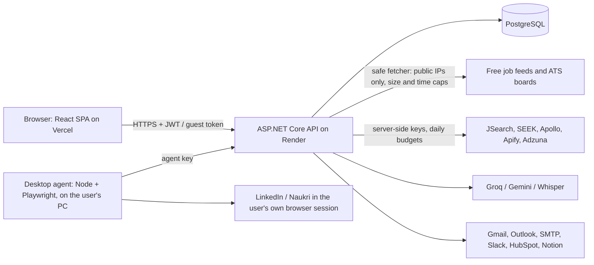

# OpportunityPilot

**One pipeline that finds work for two people: a job seeker, and the sales team of a staffing company.**
Search 13+ job sites at once, score every result with quoted evidence, approve in batches, then apply or reach out — by tapping or by voice. Nothing is sent or applied without your approval.

**Live demo:** https://opportunity-pilot-webapp.vercel.app → click **Continue as guest** (no sign-up; data resets on restart).
API: https://opportunitypilotwebapi.onrender.com (free host: the first request can take ~1 minute while it wakes).

· React 19 · TypeScript 6 · Vite 8 · .NET 10 API · PostgreSQL · Playwright agent · Groq / Gemini / Whisper

## The problem

- **Job seekers** check LinkedIn, Indeed, Naukri, remote boards and company career pages one by one, and lose track of what they applied to.
- **Staffing sales teams** need to know *which foreign companies are hiring contract or remote engineers right now*, so they can offer their bench. That signal is spread over dozens of boards in every region.

Both are the same job: **find → score → shortlist → act → follow up.**

## What OpportunityPilot does

| Step | Candidate workspace | Sales workspace |
|---|---|---|
| **Find** | Jobs from free feeds (Arbeitnow, Jobicy, We Work Remotely, Remotive, Remote OK, Himalayas, The Muse, Instahyre, Adzuna), LinkedIn/Indeed/SEEK/Naukri (credits), Wellfound, Workday/Greenhouse/Lever/Ashby company boards | The same sources, **grouped by hiring company**; Apollo people search; region picker (Global remote, India, Europe, UK, US & Canada, Middle East, ANZ, APAC); **Contract only + Remote only on by default** |
| **Score** | Fit out of 100 with the evidence quoted from the posting (rules engine, no black box) | Lead score from hiring signals |
| **Approve** | Batch approval queue; optional auto-approve above a score | Same, per company |
| **Act** | Apply link, tailored resume (.docx), or the local desktop agent (stops at any login/CAPTCHA) | Drafted emails per lead, approve, send from Gmail/Outlook/SMTP, or export |
| **Follow up** | Reply detection (IMAP), follow-up drafts, interview tracker, shareable progress page | Deals, submissions, interviews, follow-ups |

Voice from any screen: *"Find remote React contract roles in Germany"* → the assistant plans it, you confirm, it runs.

## How AI is used

| Feature | Model | Where (API repo) | Guardrails |
|---|---|---|---|
| Campaign goal → search criteria | Gemini / Groq (Llama) | `Application/Ai/AiService.cs`, `Infrastructure/Ai/GeminiLlmClient.cs`, `GroqLlmClient.cs` | JSON-only output validated against the schema; rules fallback when no key or on error; daily budget |
| Voice assistant ("what next?", run one confirmed action) | Groq | `Application/Assistant/AssistantService.cs` | Knows only the user's own figures; proposes, the user taps to run |
| Speech to text / natural voice | Groq Whisper `whisper-large-v3` (OpenAI `whisper-1` fallback), browser speech | `Api/Controllers/VoiceController.cs`, web `src/features/voice/` | Per-user rate limit; guests blocked |
| Draft rewrite, profile "Improve with AI" | Groq / Gemini | `Application/Drafts/DraftRewriteService.cs`, `Application/Profiles/ProfileImproveService.cs` | Shown as an AI suggestion, never sent automatically |

Scoring itself is a **transparent rules engine** (every point has a quoted reason), so results are explainable. Every AI answer carries its `source` and a fallback reason; keys stay on the server.

## Architecture

More: [docs/ARCHITECTURE.md](docs/ARCHITECTURE.md).

## Run it in 5 steps

1. Clone both repos side by side: `OpportunityPilotWebApi` and `OpportunityPilotWebapp`.
2. API in demo mode (no database, no keys, guest sign-in): `cd OpportunityPilotWebApi && ConnectionStrings__Main= Cors__AllowedOrigins__0=http://localhost:5173 ASPNETCORE_URLS=http://localhost:5051 dotnet run --no-launch-profile --project src/OpportunityPilot.Api`
3. Web: `cd OpportunityPilotWebapp && npm install && cp .env.example .env.local`, then clear `VITE_DEV_AUTH=` in `.env.local` (guest mode)
4. `npm run dev` → http://localhost:5173
5. Click **Continue as guest**, then **Find** → type a role → **Search**.

## Quality

| Check | Command | Today |
|---|---|---|
| Typecheck | `npm run typecheck` | 0 errors |
| Lint (oxlint) | `npm run lint` | 0 warnings |
| Unit tests (Vitest) | `npm test` | 590+ tests |
| Build | `npm run build` | lazy-loaded routes; `docx` loaded only when a resume is exported |
| Layout + accessibility | `npm run check:shell`, `npm run check:devices` | every route × 1280/1024/375 × light/dark, axe WCAG 2.1 AA 0 violations |
| API | `dotnet test` in the API repo | 580+ xUnit tests incl. Postgres integration tests (Testcontainers) |

## Security and data honesty

- Keys for paid sources and AI live only on the server; everything in `VITE_*` is public by design.
- Guests can explore everything except paid parts (voice, AI, live paid boards, sending).
- Per-visitor rate limits, 4 MB body cap, security headers; the server fetcher only reaches public IPs.
- The app never scrapes behind a login server-side; LinkedIn/Naukri automation runs only in the user's own desktop agent and stops at any check.
- Saved results are always labelled with their date and "not live".

See [SECURITY.md](SECURITY.md).

## About the data (for reviewers)

This MVP runs on free or low-credit plans: SEEK (20 searches), Apollo (50 credits), JSearch for Indeed and LinkedIn (200 searches a month), Apify for Naukri. When a plan's credits run out, or for a guest, the search tabs offer **saved results** from real searches, labelled with their date and "not live". The free feeds are always live.

## Where to read next

| Need | File |
|---|---|
| Architecture and data flow | [docs/ARCHITECTURE.md](docs/ARCHITECTURE.md) |
| Every route and its status | [docs/SCREEN_MAP.md](docs/SCREEN_MAP.md) |
| Screen behaviour per user | [docs/SHARED_FLOW.md](docs/SHARED_FLOW.md), [docs/CANDIDATE_FLOW.md](docs/CANDIDATE_FLOW.md), [docs/SALES_FLOW.md](docs/SALES_FLOW.md) |
| Design system rules | [DESIGN.md](DESIGN.md) |
| Env vars, deploy targets, auth modes | [docs/PRODUCT.md](docs/PRODUCT.md), [docs/SETUP.md](docs/SETUP.md) |
| Known gaps and open decisions | [docs/open-questions.md](docs/open-questions.md) |
| **Built with Claude Code** — our AI dev workflow: rules, skills, slash commands, hooks | [CLAUDE.md](CLAUDE.md), [skills/](skills/), [.claude/commands/](.claude/commands/), [.claude/settings.json](.claude/settings.json) |

## License

See [LICENSE](LICENSE).
