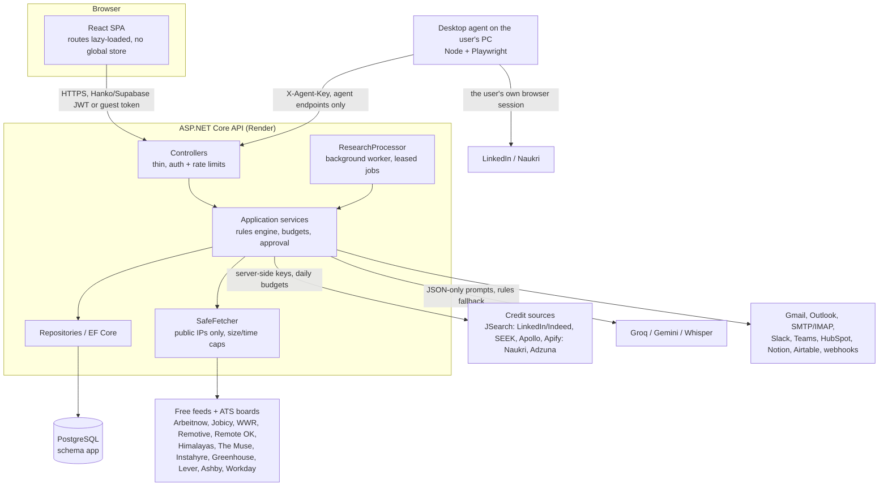
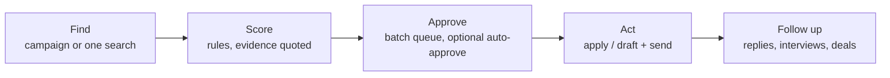

# Architecture

OpportunityPilot is two repositories that deploy separately:

| Repo | What | Hosting |
|---|---|---|
| `OpportunityPilotWebapp` (this one) | React 19 SPA, Vite build, no server code | Vercel (also a Render static-site blueprint) |
| `OpportunityPilotWebApi` | ASP.NET Core (.NET 10) API, Clean Architecture, plus `agent/` (the local desktop agent) | Render (Docker), PostgreSQL |

## System view

## The pipeline (both workspaces)

- **Find**: a campaign (saved criteria, repeatable on a schedule) queues a research job; the `ResearchProcessor` gathers from the chosen sources through `SafeFetcher` or the provider clients, de-duplicates, and stores opportunities with evidence. One-off searches on **Find** (All sites, Apollo, SEEK…) read live and can be turned into a campaign in one tap.
- **Score**: `Application/Research/Rules` — every point of the fit score has a reason quoted from the posting. No model is used for scoring, so results are explainable and cheap.
- **Approve**: research never changes an opportunity's status; only the person (or an explicit auto-approve threshold they set) does.
- **Act**: Candidate — apply link, tailored resume, or the desktop agent. Sales — drafted emails, approved one by one or in a visible queue, sent from the person's own mailbox.
- **Follow up**: IMAP reply detection, follow-up drafts, interview tracker, deals and submissions.

## Web app structure

| Path | Holds |
|---|---|
| `src/App.tsx` | Route table (data router), lazy pages, auth gate |
| `src/lib/` | `api()` fetch wrapper (auth headers, problem details, wake-up retries), `useApi` GET hook, config, DTO types |
| `src/features/<area>/` | One folder per area; `<Name>Page.tsx` screens and `<area>Model.ts` pure logic with co-located Vitest tests |
| `src/features/wellfound/` | **Find**: All sites (`AllSitesPanel`, `allSitesModel`), the source catalogue and region picker (`sourcesModel`, `SitePicker`), the shared contract/remote rule (`jobSignals`), Apollo, board tabs, saved results |
| `src/features/voice/` | Voice assistant: speech capture, Whisper fallback, plan → confirm → run |
| `src/styles/` | Design tokens and component CSS (rules in `DESIGN.md`) |

Rules that shape the code: all data comes from the API (no direct database access), external links only through `safeHref()`, no secrets in `VITE_*`, every list is cards in the simple view and tables only in Advanced, axe WCAG 2.1 AA must report 0 violations.

## API structure (summary)

Domain ← Application ← Infrastructure ← Api. Every query is owner-scoped from the signed-in user; enums are stored as strings; migrations exist for both SQL Server (local) and PostgreSQL (cloud); without a connection string the API runs in demo mode (in-memory, guest sign-in). Details: the API repo's `CLAUDE.md` and `docs/`.

## Security boundaries

- The server never automates a logged-in site; LinkedIn/Naukri actions happen only in the desktop agent, in the user's own browser, and stop at any login check or CAPTCHA.
- Server-side fetches go through `SafeFetcher` (public addresses only, redirects re-checked, response size and time caps).
- Paid providers and AI have daily budgets and per-visitor rate limits; guests cannot use them.
- Mailbox and connector secrets are encrypted at rest (AES-GCM).

## Folder map (moved from CLAUDE.md, 2026-10-26)

| Path | Holds | Rule |
|---|---|---|
| `src/main.tsx` | Mounts `<App/>`, imports `tokens.css`, then `styles/app/*.css` in order, then `v5.css` and `auth-v6.css` | Nothing else goes here |
| `src/App.tsx` | Route table (data router), `AuthGate`, `NotFound` | Every new route is added here **and** to `docs/SCREEN_MAP.md` |
| `src/lib/` | `api.ts` (fetch wrapper, `ApiError`, `ApiUnreachableError`), `config.ts` (public env), `useApi.ts`, `supabase.ts` (auth client only), `types.ts` (DTOs), `download.ts` | Framework-free helpers shared by several features |
| `src/components/` | Shared UI: `ErrorNotice` (inline, or the "Could not load X" card with `what`), `States` (`EmptyState`, `FilteredEmpty`, `LoadingState` with API-waking, `NotBuiltState`), `StatusBadge`/`Badge`, `TagInput` | Only components used by two or more features. Every page uses `States` for loading / empty / waking — no hand-made "Loading…" text or centred empty cards |
| `src/features/<area>/` | One folder per area: `auth`, `shell`, `overview`, `profiles`, `campaigns`, `research`, `opportunities`, `approvals`, `applications`, `integrations`, `settings`, `placeholder` | Screen components are `<Name>Page.tsx` (or a step/section component next to its page) |
| `src/features/<area>/<area>Model.ts` | Pure logic: labels, validation (`draftProblems`), path builders, normalisers, formatters | No React, no fetch, no DOM — so it can be unit-tested in Node. Existing: `campaignModel`, `researchModel`, `opportunityModel`, `approvalModel`, `applicationStatus`, `profileFields` |
| `src/features/<area>/*.test.ts` | Vitest tests, co-located with the model they test | Every new model function gets a test |
| `src/styles/tokens.css` | Design tokens (`--op-*`) | Copied from `../opportunitypilot-ui/tokens.css`; change the design source first, then copy |
| `src/styles/app/*.css` | Component classes split by area: `base`, `layout`, `accounts`, `screens`, `features`, `refinements`, `find-drawer` (order matters: later files refine earlier ones) | Uses tokens only; add new rules to the file of their area |
| `docs/` | Flow docs, screen map, project reference, open questions | See the reference table below |
| `skills/` | `prompt-master.SKILL.md` | Read when a rule below says so |
| `.claude/commands/` | `/audit-oq`, `/resolve-oq`, `/build-screen` | |
| `.claude/hooks/` | Command/write guards and the write log | Wired in `.claude/settings.json` |

**Where a new screen goes:** flow-doc entry first (role doc) → `src/features/<area>/<Name>Page.tsx` → pure logic in `<area>Model.ts` + `<area>Model.test.ts` → DTOs in `src/lib/types.ts` → route in `src/App.tsx` (with `handle: { title }`) → nav entry in `NAV` in `src/features/shell/AppShell.tsx` if it is top-level → classes in the matching `src/styles/app/*.css` → `docs/SCREEN_MAP.md`. A screen whose milestone is not built uses `NotBuiltPage` (no sample data, no dead buttons).
